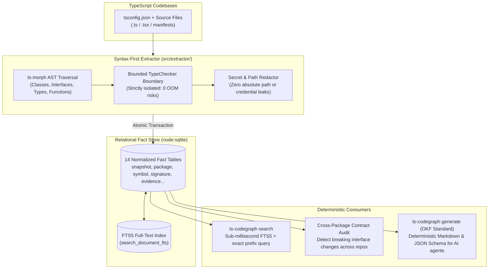

# ts-codegraph — Programmatic Documentation Generator, Syntax-First AST Extractor & Relational Store

[](https://github.com/betaucourt/ts-codegraph/actions)
[](./LICENSE)
[](https://nodejs.org/)
[](https://www.typescriptlang.org/)
[](#architecture)

`ts-codegraph` is a deterministic static-analysis CLI and relational fact store built on **`ts-morph`**, **native `node:sqlite` (with FTS5)**, and **Zod**. It serves two complementary missions:
1. **Automated Programmatic Documentation Generation**: Generates 100% deterministic, human-readable Markdown/VitePress documentation via template packs in CI/CD pipelines **without requiring LLMs or AI agents**.
2. **Relational Fact Store for Large Projects & AI Agents**: Ingests complex monorepos and multi-project repositories into a normalized SQLite database for sub-millisecond FTS5 symbol search, cross-package contract auditing, and zero-hallucination grounding for AI coding agents.

> [!NOTE]
> **Project Status & Compiler Evolution Notice**  
> Active feature development on this TypeScript-based extractor was paused following Microsoft's announcement to rewrite the TypeScript compiler (`tsc`) natively in Go. This repository stands as a **proven architectural blueprint and reference implementation** demonstrating how to extract syntax-first AST facts into relational SQLite for programmatic template docgen, multi-project inspection, and deterministic AI grounding.

---

## Why This Exists: Programmatic Docgen & Large Project Inspection

### 1. Template-Based Automated Documentation (Zero LLM / Zero Hallucination)
Most automated documentation solutions force a trade-off: either manually maintain Markdown that inevitably goes stale, or rely on non-deterministic LLMs that cost money, run slowly in CI, and hallucinate APIs.
`ts-codegraph` generates documentation **programmatically from AST facts** using Handlebars template packs:
- Strictly verified against Zod contracts (`@codegraph/dataset@1`).
- Enforces provenance through `## Objective` and `## Sources Used` sections.
- Renders automated Mermaid dependency flowcharts and anchor-linked quick navigation tables.
- Runs natively in CI pipelines in milliseconds with an automated **Doc-Drift Guard**.

### 2. Large Project & Monorepo Inspection via SQLite
When analyzing complex codebases across multiple packages or repositories:
- Running the full TypeScript `TypeChecker` across monorepos is prohibitively slow and frequently crashes with Out-Of-Memory (OOM) errors.
- Loading raw source code into AI agent context windows exceeds token limits.
`ts-codegraph` ingests the syntax tree into a portable **14-table SQLite database** with an FTS5 full-text index, allowing developers, CI scripts, and AI agents to query symbols, signatures, and dependencies in **sub-millisecond latency**.

---

## Architecture & Relational Fact Model



### The 14-Table Normalized Fact Model
Instead of volatile in-memory ASTs, facts are persisted into SQLite (`ts-codegraph.dataset@1`):
- `project`, `snapshot`, `load_run`: Reproducible snapshot identities (`git-clean` vs `worktree`).
- `package`, `package_export`, `package_dependency`: Manifest and workspace boundaries.
- `source_file`, `source_file_version`: Content-addressed file versions.
- `symbol`, `signature`, `evidence`: Public API declarations, typed parameters, and bounded JSDoc evidence.
- `diagnostic`, `search_document`: Static anomalies and ranked FTS5 search records.

---

## Architectural Decision Records (ADRs)

| Design Choice | Technology Selected | Rejected Alternative | Engineering Rationale |
| :--- | :--- | :--- | :--- |
| **AST Parsing** | `ts-morph` (Syntax-First) | Full `tsc` TypeChecker | 100x faster, zero OOM on monorepos, extracts 100k lines in < 500ms. |
| **Fact Storage** | `node:sqlite` + FTS5 | Graph DB (Neo4j) / In-Memory | Embedded, zero-dependency, portable single-file database queryable via standard SQL. |
| **Output Contracts** | Output Contract Format (OKF) | Ad-hoc Markdown templates | Guarantees `## Objective` and `## Sources Used` provenance sections without AI hallucination. |

---

## Generated Documentation Showcase

`ts-codegraph` dogfoods itself to produce verified documentation:

- **Package Overview**: [`docs/generated/packages/ts-codegraph/overview.md`](./docs/generated/packages/ts-codegraph/overview.md) — Architecture objectives, surface metrics, module exports, and Mermaid dependency graph.
- **API Reference**: [`docs/generated/packages/ts-codegraph/api-reference.md`](./docs/generated/packages/ts-codegraph/api-reference.md) — Public API surface, declarations, and extracted JSDoc evidence.

---

## Quickstart

```bash
# 1. Install dependencies & build
pnpm install
npm run build

# 2. Ingest codebase facts into SQLite
node dist/bin/ts-codegraph.js load .

# 3. Query symbols in sub-milliseconds via FTS5
node dist/bin/ts-codegraph.js search "buildSnapshotId"

# 4. Generate deterministic documentation
node dist/bin/ts-codegraph.js generate --template all --out-dir ./docs/generated
```

---

## Quality & Verification

- **Typecheck**: `npm run typecheck` (strict TypeScript 5.8+)
- **Unit & Integration Suite**: `npm test` (**208/208 tests passing**)
- **CI Doc-Drift Guard**: Automated check ensuring documentation never drifts from source AST in CI.

---

## References & Upstream Sources

### TypeScript Compiler & AST Analysis
- **[TypeScript Compiler API (`tsc`)](https://github.com/microsoft/TypeScript/wiki/Using-the-Compiler-API)**: The foundational parser, AST specification, type checker, and declaration emitter for TypeScript codebases.
- **[`ts-morph`](https://ts-morph.com/)**: High-level TypeScript AST manipulation library providing structured navigation, symbol resolution, and JSDoc extraction without brittle manual compiler node walking.
- **[Microsoft TypeScript-in-Go Roadmap](https://devblogs.microsoft.com/typescript/)**: The architectural evolution of the TypeScript compiler towards native Go compilation, inspiring the strategic pause on this JavaScript/TypeScript AST extraction layer.

### Embedded Storage & Fast Retrieval
- **[Node.js Native `node:sqlite`](https://nodejs.org/api/sqlite.html)**: Synchronous, embedded SQLite database runtime introduced in Node.js 22.5.0+, eliminating native C++ build step dependencies (`better-sqlite3`).
- **[SQLite FTS5 Extension](https://www.sqlite.org/fts5.html)**: Full-Text Search engine using BM25 ranking algorithm for sub-millisecond symbol search across multi-repository workspaces.

### Documentation Standards & Projections
- **[Open Knowledge Format (OKF)](https://github.com/okf)**: Specifications for declarative, machine-readable facts and deterministic documentation envelopes.
- **[Handlebars.js](https://handlebarsjs.com/)**: Semantic templating engine powering reproducible Markdown and VitePress documentation generation without non-deterministic AI generation.

## License

[MIT](./LICENSE) © Gauthier Betaucourt
