# ts-codegraph — Package Overview

## Objective

`ts-codegraph` is a package in project `ts-codegraph`. Syntax-first TypeScript AST fact extractor, SQLite FTS5 store, and deterministic documentation generator

## Architecture & Surface Metrics

| Metric | Value | Provenance |
| :--- | :---: | :--- |
| **Exported Surface** | `99` files | Verified package entry points |
| **Public Symbols** | `553` declarations | Syntax-first AST extraction |
| **Dependencies** | `8` packages | `package.json` manifest |
| **Evidence Records** | `154` JSDoc blocks | AST comment provenance |

```mermaid
flowchart TD
    PKG["ts-codegraph"]
    subgraph DEPS["Dependencies (8)"]
        D_0["@types/node (dev)"]
        D_1["commander (runtime)"]
        D_2["handlebars (runtime)"]
        D_3["ts-morph (runtime)"]
        D_4["tsx (dev)"]
        D_5["typescript (dev)"]
        D_6["vitest (dev)"]
        D_7["zod (runtime)"]
    end
    DEPS --> PKG
    subgraph EXPORTS["Exported Entry Points (99)"]
        E_0["src/cli/check-command.ts"]
        E_1["src/cli/generate-command.ts"]
        E_2["src/cli/load-command.ts"]
        E_3["src/cli/search-command.ts"]
        E_4["src/commands/check.ts"]
        E_5["src/commands/generate.ts"]
        E_6["src/commands/load.ts"]
        E_7["src/commands/search.ts"]
        E_8["src/contracts/diagnostics.ts"]
        E_9["src/contracts/envelopes.ts"]
        E_10["src/contracts/fixtures.ts"]
        E_11["src/contracts/okf.ts"]
        E_12["src/contracts/template-pack.ts"]
        E_13["src/contracts/timestamp.ts"]
        E_14["src/dataset/ids.ts"]
        E_15["src/dataset/migrations/001-init.ts"]
        E_16["src/dataset/migrations/index.ts"]
        E_17["src/dataset/open.ts"]
        E_18["src/dataset/rows.ts"]
        E_19["src/dataset/schema.ts"]
        E_20["src/dataset/snapshot.ts"]
        E_21["src/dataset/sqlite-runtime.ts"]
        E_22["src/extractor/extract.ts"]
        E_23["src/extractor/identifier.ts"]
        E_24["src/extractor/index.ts"]
        E_25["src/extractor/sanitize.ts"]
        E_26["src/extractor/type-checker.ts"]
        E_27["src/extractor/types.ts"]
        E_28["src/generate/document.ts"]
        E_29["src/generate/helpers.ts"]
        E_30["src/generate/packs.ts"]
        E_31["src/internal/app-paths/create.ts"]
        E_32["src/internal/app-paths/generated/app-paths-entities.ts"]
        E_33["src/internal/app-paths/index.ts"]
        E_34["src/internal/app-paths/names.ts"]
        E_35["src/internal/app-paths/resolve.ts"]
        E_36["src/internal/app-paths/types.ts"]
        E_37["src/internal/cli/exit.ts"]
        E_38["src/internal/cli/generated/cli-entities.ts"]
        E_39["src/internal/cli/index.ts"]
        E_40["src/internal/cli/output.ts"]
        E_41["src/internal/cli/program.ts"]
        E_42["src/internal/cli/types.ts"]
        E_43["src/internal/errors/core.ts"]
        E_44["src/internal/errors/generated/error-entities.ts"]
        E_45["src/internal/errors/index.ts"]
        E_46["src/internal/errors/problem-details.ts"]
        E_47["src/internal/errors/registry.ts"]
        E_48["src/internal/errors/sanitize.ts"]
        E_49["src/internal/process-runner/generated/process-runner-entities.ts"]
        E_50["src/internal/process-runner/index.ts"]
        E_51["src/internal/process-runner/policy.ts"]
        E_52["src/internal/process-runner/redact.ts"]
        E_53["src/internal/process-runner/runner.ts"]
        E_54["src/internal/process-runner/spawn.ts"]
        E_55["src/internal/process-runner/types.ts"]
        E_56["src/internal/repo-inventory/generated/repo-inventory-entities.ts"]
        E_57["src/internal/repo-inventory/git.ts"]
        E_58["src/internal/repo-inventory/index.ts"]
        E_59["src/internal/repo-inventory/manifest.ts"]
        E_60["src/internal/repo-inventory/package-manager.ts"]
        E_61["src/internal/repo-inventory/repo.ts"]
        E_62["src/internal/repo-inventory/tsconfig.ts"]
        E_63["src/internal/repo-inventory/types.ts"]
        E_64["src/internal/repo-inventory/utils.ts"]
        E_65["src/internal/repo-inventory/workspace.ts"]
        E_66["src/internal/security/audit.ts"]
        E_67["src/internal/security/generated/security-entities.ts"]
        E_68["src/internal/security/index.ts"]
        E_69["src/internal/security/log-sanitization.ts"]
        E_70["src/internal/security/path.ts"]
        E_71["src/internal/security/rate-limit.ts"]
        E_72["src/internal/security/redaction.ts"]
        E_73["src/internal/security/serialization.ts"]
        E_74["src/internal/security/types.ts"]
        E_75["src/internal/security/url.ts"]
        E_76["src/internal/source-files/generated/source-files-entities.ts"]
        E_77["src/internal/source-files/hash.ts"]
        E_78["src/internal/source-files/ignore.ts"]
        E_79["src/internal/source-files/index.ts"]
        E_80["src/internal/source-files/read.ts"]
        E_81["src/internal/source-files/scan.ts"]
        E_82["src/internal/source-files/types.ts"]
        E_83["src/internal/source-files/write.ts"]
        E_84["src/internal/sqlite/database.ts"]
        E_85["src/internal/sqlite/fts.ts"]
        E_86["src/internal/sqlite/generated/sqlite-entities.ts"]
        E_87["src/internal/sqlite/health.ts"]
        E_88["src/internal/sqlite/index.ts"]
        E_89["src/internal/sqlite/migrations.ts"]
        E_90["src/internal/sqlite/transaction.ts"]
        E_91["src/internal/sqlite/types.ts"]
        E_92["src/internal/telemetry/index.ts"]
        E_93["src/projection/dto.ts"]
        E_94["src/projection/index.ts"]
        E_95["src/render/engine.ts"]
        E_96["src/search/execute.ts"]
        E_97["src/search/query.ts"]
        E_98["src/search/rank.ts"]
    end
    PKG --> EXPORTS
```

## Exports

- `src/cli/check-command.ts`
- `src/cli/generate-command.ts`
- `src/cli/load-command.ts`
- `src/cli/search-command.ts`
- `src/commands/check.ts`
- `src/commands/generate.ts`
- `src/commands/load.ts`
- `src/commands/search.ts`
- `src/contracts/diagnostics.ts`
- `src/contracts/envelopes.ts`
- `src/contracts/fixtures.ts`
- `src/contracts/okf.ts`
- `src/contracts/template-pack.ts`
- `src/contracts/timestamp.ts`
- `src/dataset/ids.ts`
- `src/dataset/migrations/001-init.ts`
- `src/dataset/migrations/index.ts`
- `src/dataset/open.ts`
- `src/dataset/rows.ts`
- `src/dataset/schema.ts`
- `src/dataset/snapshot.ts`
- `src/dataset/sqlite-runtime.ts`
- `src/extractor/extract.ts`
- `src/extractor/identifier.ts`
- `src/extractor/index.ts`
- `src/extractor/sanitize.ts`
- `src/extractor/type-checker.ts`
- `src/extractor/types.ts`
- `src/generate/document.ts`
- `src/generate/helpers.ts`
- `src/generate/packs.ts`
- `src/internal/app-paths/create.ts`
- `src/internal/app-paths/generated/app-paths-entities.ts`
- `src/internal/app-paths/index.ts`
- `src/internal/app-paths/names.ts`
- `src/internal/app-paths/resolve.ts`
- `src/internal/app-paths/types.ts`
- `src/internal/cli/exit.ts`
- `src/internal/cli/generated/cli-entities.ts`
- `src/internal/cli/index.ts`
- `src/internal/cli/output.ts`
- `src/internal/cli/program.ts`
- `src/internal/cli/types.ts`
- `src/internal/errors/core.ts`
- `src/internal/errors/generated/error-entities.ts`
- `src/internal/errors/index.ts`
- `src/internal/errors/problem-details.ts`
- `src/internal/errors/registry.ts`
- `src/internal/errors/sanitize.ts`
- `src/internal/process-runner/generated/process-runner-entities.ts`
- `src/internal/process-runner/index.ts`
- `src/internal/process-runner/policy.ts`
- `src/internal/process-runner/redact.ts`
- `src/internal/process-runner/runner.ts`
- `src/internal/process-runner/spawn.ts`
- `src/internal/process-runner/types.ts`
- `src/internal/repo-inventory/generated/repo-inventory-entities.ts`
- `src/internal/repo-inventory/git.ts`
- `src/internal/repo-inventory/index.ts`
- `src/internal/repo-inventory/manifest.ts`
- `src/internal/repo-inventory/package-manager.ts`
- `src/internal/repo-inventory/repo.ts`
- `src/internal/repo-inventory/tsconfig.ts`
- `src/internal/repo-inventory/types.ts`
- `src/internal/repo-inventory/utils.ts`
- `src/internal/repo-inventory/workspace.ts`
- `src/internal/security/audit.ts`
- `src/internal/security/generated/security-entities.ts`
- `src/internal/security/index.ts`
- `src/internal/security/log-sanitization.ts`
- `src/internal/security/path.ts`
- `src/internal/security/rate-limit.ts`
- `src/internal/security/redaction.ts`
- `src/internal/security/serialization.ts`
- `src/internal/security/types.ts`
- `src/internal/security/url.ts`
- `src/internal/source-files/generated/source-files-entities.ts`
- `src/internal/source-files/hash.ts`
- `src/internal/source-files/ignore.ts`
- `src/internal/source-files/index.ts`
- `src/internal/source-files/read.ts`
- `src/internal/source-files/scan.ts`
- `src/internal/source-files/types.ts`
- `src/internal/source-files/write.ts`
- `src/internal/sqlite/database.ts`
- `src/internal/sqlite/fts.ts`
- `src/internal/sqlite/generated/sqlite-entities.ts`
- `src/internal/sqlite/health.ts`
- `src/internal/sqlite/index.ts`
- `src/internal/sqlite/migrations.ts`
- `src/internal/sqlite/transaction.ts`
- `src/internal/sqlite/types.ts`
- `src/internal/telemetry/index.ts`
- `src/projection/dto.ts`
- `src/projection/index.ts`
- `src/render/engine.ts`
- `src/search/execute.ts`
- `src/search/query.ts`
- `src/search/rank.ts`

## Dependencies

- `@types/node` (`^22.15.21`) — dev
- `commander` (`^14.0.0`) — runtime
- `handlebars` (`4.7.9`) — runtime
- `ts-morph` (`26.0.0`) — runtime
- `tsx` (`^4.19.4`) — dev
- `typescript` (`^5.8.3`) — dev
- `vitest` (`^3.2.3`) — dev
- `zod` (`^3.25.76`) — runtime

## Sources Used

- Package manifest `package.json` at snapshot `snapshot:v1:project:v1:e8b73bd9a7125baf:worktree:8f2933f00f682fab5cb09200025c55028d1c97b6bdf0f7b1e7abbecb9b7ee0e0`.
- `CHECK_GATE_IDS` (constant) — documentation evidence.
- `CHECK_TOOL_VERSION` (constant) — documentation evidence.
- `CheckCliOptions` (interface) — documentation evidence.
- `CheckCliOverrides` (interface) — documentation evidence.
- `CliCommandGroupDefinition` (interface) — documentation evidence.
- `DATASET_APP_NAME` (constant) — documentation evidence.
- `DATASET_DB_FILENAME` (constant) — documentation evidence.
- `DATASET_MIGRATIONS` (constant) — documentation evidence.
- `DATASET_SCHEMA_ID` (constant) — documentation evidence.
- `DATASET_SCHEMA_VERSION` (constant) — documentation evidence.
- `DATASET_SUBDIR` (constant) — documentation evidence.
- `DATASET_TABLES` (constant) — documentation evidence.
- `DEFAULT_HASH_HEX_LENGTH` (constant) — documentation evidence.
- `DEFAULT_TEMPLATE_PACK` (constant) — documentation evidence.
- `DEFAULT_TEMPLATE_PACKS_DIR` (constant) — documentation evidence.
- `DatasetContainmentError` (class) — documentation evidence.
- `DeclarationFact` (interface) — documentation evidence.
- `DeclarationKind` (type-alias) — documentation evidence.
- `DeclaredTypeResolution` (interface) — documentation evidence.
- `ENTITY_IDS` (constant) — documentation evidence.
- `ENTITY_IDS` (constant) — documentation evidence.
- `ENTITY_IDS` (constant) — documentation evidence.
- `ENTITY_IDS` (constant) — documentation evidence.
- `ENTITY_IDS` (constant) — documentation evidence.
- `ENTITY_IDS` (constant) — documentation evidence.
- `ENTITY_IDS` (constant) — documentation evidence.
- `ENTITY_IDS` (constant) — documentation evidence.
- `ERROR_CODES` (constant) — documentation evidence.
- `ERROR_CODES` (constant) — documentation evidence.
- `ERROR_CODES` (constant) — documentation evidence.
- `ERROR_CODES` (constant) — documentation evidence.
- `ERROR_CODES` (constant) — documentation evidence.
- `ERROR_CODES` (constant) — documentation evidence.
- `ERROR_CODES` (constant) — documentation evidence.
- `ERROR_CODES` (constant) — documentation evidence.
- `ExtractPackageFactsInput` (interface) — documentation evidence.
- `ExtractorSourceFile` (interface) — documentation evidence.
- `FORBIDDEN_TABLES` (constant) — documentation evidence.
- `GENERATE_TOOL_VERSION` (constant) — documentation evidence.
- `GenerateCliOptions` (interface) — documentation evidence.
- `GenerateRefusedError` (class) — documentation evidence.
- `HashedIdType` (type-alias) — documentation evidence.
- `ID_VERSION` (constant) — documentation evidence.
- `IdCollisionEntry` (interface) — documentation evidence.
- `IncludedFile` (interface) — documentation evidence.
- `KIND_ORDER` (constant) — documentation evidence.
- `LOAD_TOOL_VERSION` (constant) — documentation evidence.
- `LoadCliOptions` (interface) — documentation evidence.
- `LoadCliOverrides` (interface) — documentation evidence.
- `LoadPhase` (type-alias) — documentation evidence.
- `MAX_EVIDENCE_LENGTH` (constant) — documentation evidence.
- `MAX_SIGNATURE_LENGTH` (constant) — documentation evidence.
- `ManagedDatabase` (interface) — documentation evidence.
- `NOW_TRAVERSAL_POLICY` (constant) — documentation evidence.
- `NormalizedQuery` (interface) — documentation evidence.
- `PackageFacts` (interface) — documentation evidence.
- `ProcessCommandSnapshot` (interface) — documentation evidence.
- `ProcessRunnerPolicySnapshot` (interface) — documentation evidence.
- `ProjectionOptions` (interface) — documentation evidence.
- `PureHelper` (type-alias) — documentation evidence.
- `ReexportResolution` (interface) — documentation evidence.
- `SEARCH_DOCUMENT_FTS_COLUMNS` (constant) — documentation evidence.
- `SEARCH_DOCUMENT_FTS_TABLE` (constant) — documentation evidence.
- `SEARCH_TOOL_VERSION` (constant) — documentation evidence.
- `SanitizedEvidence` (interface) — documentation evidence.
- `SearchCliOptions` (interface) — documentation evidence.
- `SearchKind` (type-alias) — documentation evidence.
- `SectionRecord` (interface) — documentation evidence.
- `SnapshotSummary` (interface) — documentation evidence.
- `SourceRange` (interface) — documentation evidence.
- `SqlParam` (type-alias) — documentation evidence.
- `StrictTemplate` (type-alias) — documentation evidence.
- `TELEMETRY_ATTRIBUTES` (constant) — documentation evidence.
- `TELEMETRY_ATTRIBUTES` (constant) — documentation evidence.
- `TELEMETRY_ATTRIBUTES` (constant) — documentation evidence.
- `TELEMETRY_ATTRIBUTES` (constant) — documentation evidence.
- `TELEMETRY_ATTRIBUTES` (constant) — documentation evidence.
- `TELEMETRY_ATTRIBUTES` (constant) — documentation evidence.
- `TELEMETRY_ATTRIBUTES` (constant) — documentation evidence.
- `TELEMETRY_METRICS` (constant) — documentation evidence.
- `TEMPLATE_PACK_MANIFEST_FILE` (constant) — documentation evidence.
- `TIER_RANK` (constant) — documentation evidence.
- `TemplateName` (type-alias) — documentation evidence.
- `appendLoadTimingEntry` (function) — documentation evidence.
- `assertDatasetIdentifiersSafe` (function) — documentation evidence.
- `assertDatasetPathContained` (function) — documentation evidence.
- `buildCitationId` (function) — documentation evidence.
- `buildDiagnosticId` (function) — documentation evidence.
- `buildEvidenceId` (function) — documentation evidence.
- `buildGeneratedDocId` (function) — documentation evidence.
- `buildGeneratedSectionId` (function) — documentation evidence.
- `buildHashedId` (function) — documentation evidence.
- `buildPackageId` (function) — documentation evidence.
- `buildProjectId` (function) — documentation evidence.
- `buildSearchDocId` (function) — documentation evidence.
- `buildSearchFtsCreateStatement` (function) — documentation evidence.
- `buildSignatureId` (function) — documentation evidence.
- `buildSnapshotSummary` (function) — documentation evidence.
- `buildSourceFileId` (function) — documentation evidence.
- `buildSourceFileVersionId` (function) — documentation evidence.
- `buildSymbolId` (function) — documentation evidence.
- `checkCommandDefinition` (constant) — documentation evidence.
- `checkManagedDatabaseHealth` (function) — documentation evidence.
- `closeDataset` (function) — documentation evidence.
- `compileStrict` (function) — documentation evidence.
- `computeSnapshotId` (function) — documentation evidence.
- `computeSnapshotIdentity` (function) — documentation evidence.
- `countRows` (function) — documentation evidence.
- `createSourceExplorer` (function) — documentation evidence.
- `declaredTypeTextForUnannotatedExport` (function) — documentation evidence.
- `deriveProjectKey` (function) — documentation evidence.
- `detectFileKind` (function) — documentation evidence.
- `detectIdCollisions` (function) — documentation evidence.
- `executeCheckCommand` (function) — documentation evidence.
- `executeLoadCommand` (function) — documentation evidence.
- `extractPackageFacts` (function) — documentation evidence.
- `hashFileContent` (function) — documentation evidence.
- `headingSlug` (function) — documentation evidence.
- `indexSearchDocument` (function) — documentation evidence.
- `initMigration` (constant) — documentation evidence.
- `isExecutableAllowed` (function) — documentation evidence.
- `loadCommandDefinition` (constant) — documentation evidence.
- `managedAll` (function) — documentation evidence.
- `managedGet` (function) — documentation evidence.
- `managedRun` (function) — documentation evidence.
- `normalizeMarkdown` (function) — documentation evidence.
- `normalizeRepoRelativePath` (function) — documentation evidence.
- `openDataset` (function) — documentation evidence.
- `openManagedDatabase` (function) — documentation evidence.
- `packageSlug` (function) — documentation evidence.
- `parseCheckArgs` (function) — documentation evidence.
- `parsePnpmWorkspaceYaml` (function) — documentation evidence.
- `projectDirKey` (function) — documentation evidence.
- `readBoundedTextFile` (function) — documentation evidence.
- `redactProcessResult` (function) — documentation evidence.
- `redactText` (function) — documentation evidence.
- `resolveDatasetPaths` (function) — documentation evidence.
- `resolveExplicitReexport` (function) — documentation evidence.
- `runCheck` (function) — documentation evidence.
- `runLoad` (function) — documentation evidence.
- `runManagedMigrations` (function) — documentation evidence.
- `safePositiveInt` (function) — documentation evidence.
- `sanitizeEvidenceText` (function) — documentation evidence.
- `sanitizeSignatureText` (function) — documentation evidence.
- `slugify` (function) — documentation evidence.
- `snapshotAndValidateProcessCommand` (function) — documentation evidence.
- `snapshotAndValidateProcessRunnerPolicy` (function) — documentation evidence.
- `splitIdentifier` (function) — documentation evidence.
- `truncateHash` (function) — documentation evidence.
- `validateCommandEnv` (function) — documentation evidence.
- `validateProcessRunnerPolicy` (function) — documentation evidence.
- `validateSourceFilePolicy` (function) — documentation evidence.
- `withDatasetTransaction` (function) — documentation evidence.
- `withManagedTransaction` (function) — documentation evidence.
