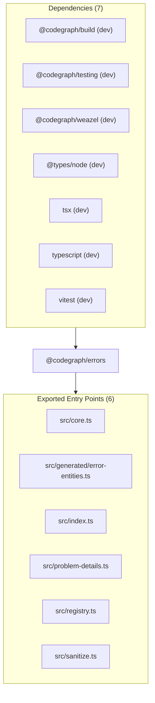

# @codegraph/errors — Package Overview

## Objective

`@codegraph/errors` is a package in project `@codegraph/errors`. Shared runtime error model for the CodeGraph/pay2 portfolio

## Architecture & Surface Metrics

| Metric | Value | Provenance |
| :--- | :---: | :--- |
| **Exported Surface** | `6` files | Verified package entry points |
| **Public Symbols** | `33` declarations | Syntax-first AST extraction |
| **Dependencies** | `7` packages | `package.json` manifest |
| **Evidence Records** | `2` JSDoc blocks | AST comment provenance |

## Exports

- `src/core.ts`
- `src/generated/error-entities.ts`
- `src/index.ts`
- `src/problem-details.ts`
- `src/registry.ts`
- `src/sanitize.ts`

## Dependencies

- `@codegraph/build` (`workspace:*`) — dev
- `@codegraph/testing` (`workspace:*`) — dev
- `@codegraph/weazel` (`workspace:*`) — dev
- `@types/node` (`^22.15.21`) — dev
- `tsx` (`^4.19.4`) — dev
- `typescript` (`^5.8.3`) — dev
- `vitest` (`^3.2.3`) — dev

## Sources Used

- Package manifest `package.json` at snapshot `snapshot:v1:project:v1:7587815a6db86532:worktree:eb35fbb8196f49ba24df029faad6ec0236fc98b9d8d7243b7456506f3e1e9faf`.
- `ENTITY_IDS` (constant) — documentation evidence.
- `ERROR_CODES` (constant) — documentation evidence.
