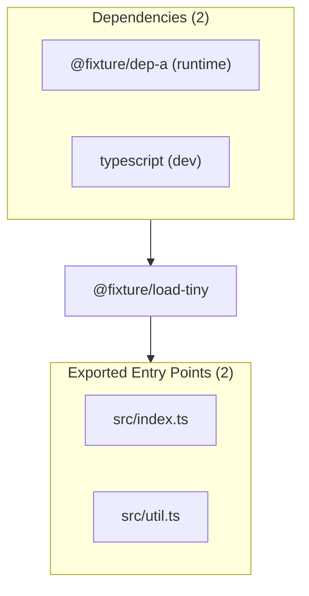

# @fixture/load-tiny — Package Overview

## Objective

`@fixture/load-tiny` is a package in project `@fixture/load-tiny`.

## Architecture & Surface Metrics

| Metric | Value | Provenance |
| :--- | :---: | :--- |
| **Exported Surface** | `2` files | Verified package entry points |
| **Public Symbols** | `4` declarations | Syntax-first AST extraction |
| **Dependencies** | `2` packages | `package.json` manifest |
| **Evidence Records** | `3` JSDoc blocks | AST comment provenance |

## Exports

- `src/index.ts`
- `src/util.ts`

## Dependencies

- `@fixture/dep-a` (`^1.0.0`) — runtime
- `typescript` (`^5.8.3`) — dev

## Sources Used

- Package manifest `package.json` at snapshot `snapshot:v1:project:v1:8423430b9f07e8ae:worktree:cfaa933199bac7c768498f2dee4dcdeda453ff22c1ad7100fc78ad0d5bd30e23`.
- `UTIL_VERSION` (constant) — documentation evidence.
- `Widget` (class) — documentation evidence.
- `createWidget` (function) — documentation evidence.
