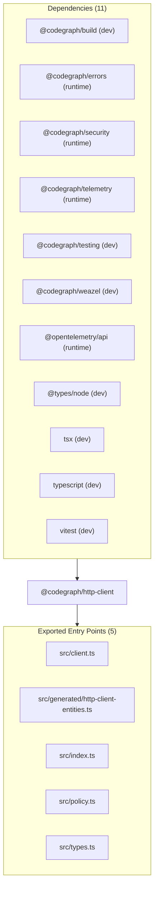

# @codegraph/http-client — Package Overview

## Objective

`@codegraph/http-client` is a package in project `@codegraph/http-client`. Safe outbound HTTP wrapper with timeout, retry/backoff, redirect policy, max body, JSON/text parsing, SSRF protection, trace propagation, and telemetry

## Architecture & Surface Metrics

| Metric | Value | Provenance |
| :--- | :---: | :--- |
| **Exported Surface** | `5` files | Verified package entry points |
| **Public Symbols** | `28` declarations | Syntax-first AST extraction |
| **Dependencies** | `11` packages | `package.json` manifest |
| **Evidence Records** | `15` JSDoc blocks | AST comment provenance |

## Exports

- `src/client.ts`
- `src/generated/http-client-entities.ts`
- `src/index.ts`
- `src/policy.ts`
- `src/types.ts`

## Dependencies

- `@codegraph/build` (`workspace:*`) — dev
- `@codegraph/errors` (`workspace:*`) — runtime
- `@codegraph/security` (`workspace:*`) — runtime
- `@codegraph/telemetry` (`workspace:*`) — runtime
- `@codegraph/testing` (`workspace:*`) — dev
- `@codegraph/weazel` (`workspace:*`) — dev
- `@opentelemetry/api` (`^1.9.1`) — runtime
- `@types/node` (`^22.15.21`) — dev
- `tsx` (`^4.19.4`) — dev
- `typescript` (`^5.8.3`) — dev
- `vitest` (`^3.2.3`) — dev

## Sources Used

- Package manifest `package.json` at snapshot `snapshot:v1:project:v1:f9954c252c535953:worktree:4b437bdb10ad7d1cd6adbf417b756baa35d9c72236d4badc3ae2dee8a85684d2`.
- `ENTITY_IDS` (constant) — documentation evidence.
- `ERROR_CODES` (constant) — documentation evidence.
- `HttpClient` (interface) — documentation evidence.
- `HttpClientResult` (interface) — documentation evidence.
- `MAX_REDIRECTS` (constant) — documentation evidence.
- `MAX_RETRY_ATTEMPTS` (constant) — documentation evidence.
- `MAX_TIMEOUT_MS` (constant) — documentation evidence.
- `MIN_REDIRECTS` (constant) — documentation evidence.
- `MIN_RETRY_ATTEMPTS` (constant) — documentation evidence.
- `MIN_TIMEOUT_MS` (constant) — documentation evidence.
- `TELEMETRY_ATTRIBUTES` (constant) — documentation evidence.
- `TELEMETRY_METRICS` (constant) — documentation evidence.
- `TELEMETRY_SPANS` (constant) — documentation evidence.
- `snapshotAndResolvePolicy` (function) — documentation evidence.
- `validateHttpClientPolicy` (function) — documentation evidence.
