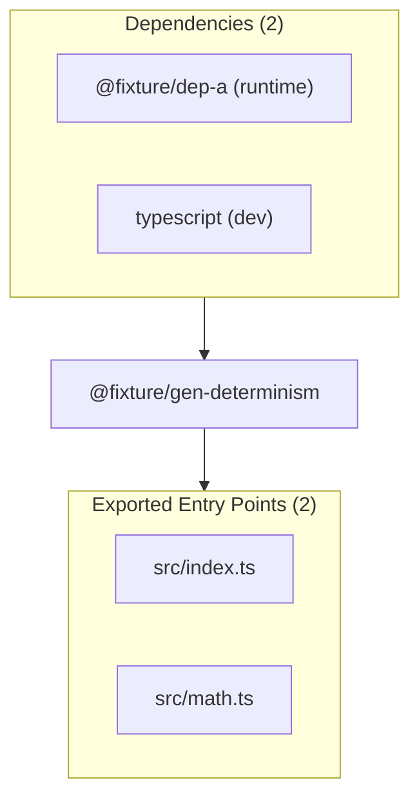

# @fixture/gen-determinism — Package Overview

## Objective

`@fixture/gen-determinism` is a package in project `@fixture/gen-determinism`.

## Architecture & Surface Metrics

| Metric | Value | Provenance |
| :--- | :---: | :--- |
| **Exported Surface** | `2` files | Verified package entry points |
| **Public Symbols** | `4` declarations | Syntax-first AST extraction |
| **Dependencies** | `2` packages | `package.json` manifest |
| **Evidence Records** | `3` JSDoc blocks | AST comment provenance |

## Exports

- `src/index.ts`
- `src/math.ts`

## Dependencies

- `@fixture/dep-a` (`^1.0.0`) — runtime
- `typescript` (`^5.8.3`) — dev

## Sources Used

- Package manifest `package.json` at snapshot `snapshot:v1:project:v1:2ee6b371758bd145:worktree:74dbb6f072703e473ecc00ad04ba31b5a22c8629632435f2d12fb8fedee655e9`.
- `Counter` (class) — documentation evidence.
- `ZERO` (constant) — documentation evidence.
- `createCounter` (function) — documentation evidence.
